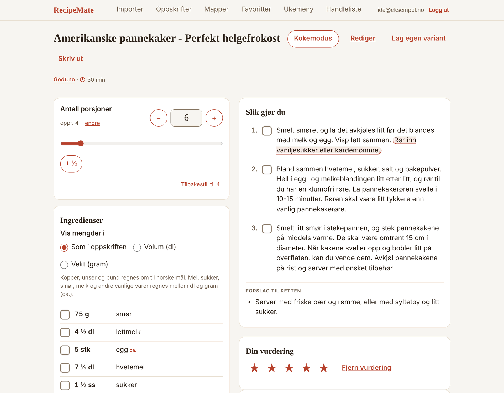
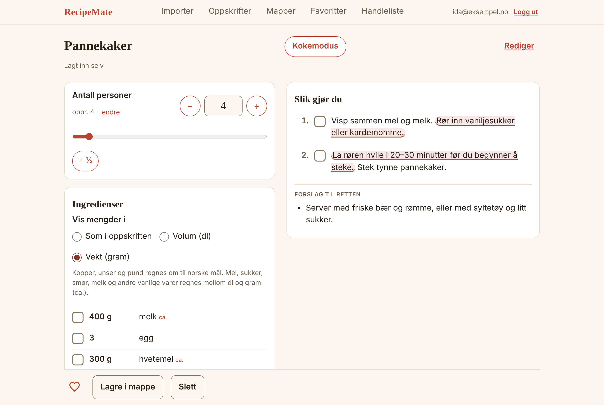

# G111 — MHN

Gruppeprosjekt i **IBE160 Programmering med KI** ved Høgskolen i Molde, høsten 2026 (15 studiepoeng).

Repoet inneholder applikasjonen og dokumentasjon av utvikling, testing og kvalitetssikring med KI.

## Medlemmer

- Maja Hjulstad Nilsen

## Om appen

**RecipeMate** er en matlagingsassistent for oppskrifter fra nettet. Du limer inn en lenke (eller skriver inn oppskriften selv), og appen viser oppskriften i et fast og ryddig format der du kan velge antall porsjoner, slik at alle mengder regnes om med en gang. Oppskrifter kan lagres i Oppskrifter, i mapper og som favoritter.



**For hvem:** alle som lager mat fra oppskrifter på nettet og må regne om mengdene når det varierer hvor mange som skal spise.

**Hva appen gjør:**

- Importerer en oppskrift fra en lenke (JSON-LD på siden), eller du skriver den inn selv.
- Viser den i fast format og regner om alle mengder når du velger antall porsjoner.
- Lagrer oppskriftene på kontoen din (e-post og passord), i mapper og som favoritter, og du kan krysse av under matlaging.
- Gir 1–3 forslag til hvordan retten kan bli bedre. Uten nøkkel er det enkle forslag laget av regler ut fra ingrediensene og stegene (merket «Enkle forslag»); med nøkkel lager en språkmodell forslag til akkurat denne oppskriften. Forslag du tar i bruk lagres med oppskriften og vises i ingredienslisten eller ved riktig steg, merket «Forslag» (også i kokemodus og handlelisten); originalen endres ikke, og «Fjern» tar dem bort igjen.

Å hente, vise og skalere oppskrifter virker uten konto; å lagre, mapper, favoritter og handleliste krever innlogging (se «Kontoer»). Ingenting krever nøkkel eller nett unntatt språkmodellen (importen kan kjøres mot lagrede sider, se «Importere fra lenke»). Status: versjon 1 (Epic 1–4, Story 1.1–4.4) og versjon 2 (Epic 5, Story 5.1–5.13) er bygget, se «Hva appen inneholder». Åpne saker står i [`issues/`](issues/README.md) og i `_bmad-output/implementation-artifacts/deferred-work.md`.

## Hva appen inneholder

Appen er bygget i fem epics, én story om gangen. Hver story har en spec i `_bmad-output/implementation-artifacts/` og står i [`epics.md`](_bmad-output/planning-artifacts/epics.md).

### Epic 1: Les og skaler en oppskrift

- **Story 1.1, Start appen:** Next.js-prosjektet med toppmeny, visuell profil som designtokens i lys og mørk palett, felles feilmeldinger og testoppsett.
- **Story 1.2, Tolk ingredienslinjer:** «400 g mel», «1 ½ dl melk» og «2–3 ss sukker» deles i mengde, enhet og navn. Linjer uten mengde («salt og pepper») vises som de står.
- **Story 1.3, Skaler og formater mengder:** mengder regnes om med fast avrunding, brøktegn (½, ¼, ¾) og «ca.» for udelelige ting som egg og løk.
- **Story 1.4, Legg inn en oppskrift manuelt:** tittel, antall porsjoner, ingredienser og steg lagres i databasen. Ved feil lagres ingenting.
- **Story 1.5, Se oppskriften og velg antall porsjoner:** fast format med tittel, kilde, porsjonsvelger, ingredienser per seksjon og nummererte steg.
- **Story 1.6, Kryss av under matlaging:** hver ingrediens og hvert steg kan krysses av (se «Kryss av under matlaging»).

### Epic 2: Importer oppskrift fra lenke

- **Story 2.1, Les oppskriftsdata:** oppskriftsdata (JSON-LD) leses fra lagrede oppskriftssider (se «Lese oppskriftsdata»).
- **Story 2.2, Importer fra lenke:** lim inn en lenke og få oppskriften i fast format (se «Importere fra lenke»).
- **Story 2.3, Forstå hvorfor en import feilet:** tydelig norsk melding og «Legg inn selv» når siden ikke har oppskriftsdata.
- **Story 2.4, Oppgi porsjonsantall:** appen spør hvor mange oppskriften er laget for når kilden ikke sier det.

### Epic 3: Ta vare på og finn igjen

- **Story 3.1, Se samlingen:** se «Oppskrifter (samlingen)».
- **Story 3.2, Lagre og slette en oppskrift:** se «Lagre, slette og rydde».
- **Story 3.3, Sorter oppskrifter i mapper:** se «Mapper».
- **Story 3.4, Marker favoritter:** se «Favoritter».
- **Story 3.5, Rediger en oppskrift:** se «Redigere en oppskrift».

### Epic 4: Forbedringsforslag

- **Story 4.1, Forslag uten nøkkel:** «Få forslag» virker uten språkmodellnøkkel (se «Forslag»).
- **Story 4.2, Ta i bruk forslag:** forslag kan tas i bruk eller hoppes over, og de valgte lagres med oppskriften.
- **Story 4.3, Forslag fra språkmodell:** med egen nøkkel i `.env.local` lager en språkmodell forslag til akkurat denne oppskriften.
- **Story 4.4, Test hele kjerneflyten:** ende-til-ende-tester for brukerreisene og ferdig README.

### Epic 5: Versjon 2

Versjon 2 (Epic 5) kom etter at v1 var levert. Endringene i planen står i [`sprint-change-proposal-2026-11-10.md`](_bmad-output/planning-artifacts/sprint-change-proposal-2026-11-10.md), kravene i PRD §4.6 (FR-19–FR-27), og hver story har en spec i `_bmad-output/implementation-artifacts/spec-5-N-*.md`.



- **Halve porsjoner og glidebryter (5.1, 5.3):** 0,5–50 porsjoner i halve steg med «+ ½», feltet («4,5») eller glidebryteren.
- **Søk og filtrering (5.2):** søk i tittel, kilde, mappe og ingredienser på Oppskrifter, med «Bare favoritter» og mappevalg.
- **Kokemodus (5.4, 5.6):** ett steg om gangen i stor tekst, med ingrediensene steget bruker og skjermen holdt våken.
- **Velg mål (5.5, 5.9):** «Vis mengder i» som i oppskriften, volum (dl) eller vekt (gram). Kopper, unser og pund regnes om, og vanlige varer regnes mellom dl og gram (merket «ca.»).
- **Handleliste og «Har hjemme» (5.7, 5.8):** velg oppskrifter og antall, få én sammenslått liste å krysse av og kopiere, og skjul det du har hjemme.
- **Forslag som passer (5.10):** uten nøkkel lages forslagene av regler ut fra oppskriften («Enkle forslag»).
- **Forslag i oppskriften (5.11, 5.12):** et forslag du tar i bruk, står i ingredienslisten og inne i riktig steg, merket og uthevet. Originalen endres ikke.
- **Kontoer (5.13):** e-post og passord, egne oppskrifter per konto (se «Kontoer»).

### Epic 6: Videre utvikling

Kravene står i PRD §4.7 (FR-28–FR-39), og hver story har en spec i `_bmad-output/implementation-artifacts/spec-6-N-*.md`. Epic 6 bygges videre; listen under viser det som er ferdig.

- **Ingrediensforslag i listen (6.1):** et forslag som innfører en ingrediens, gir også en linje i ingredienslisten.
- **Tid (6.2):** total tid hentes fra kilden eller skrives inn selv, og vises ved hjertet og på kortene. «Hent tid fra kilden» for eldre importer.
- **Notater og sist laget (6.3):** egne notater på oppskriften, «Laget i dag» og «Sist laget … · laget N ganger».
- **Tøm «Har hjemme» (6.4b):** «Tøm listen» (med bekreftelse) fjerner alt i «Har hjemme» etter en handletur.
- **Alle uker (6.4c):** «Alle uker» på Ukemeny viser hver planlagte uke (Uke 38, Uke 39 …), nyeste først, med rettene. Hver uke åpnes på en egen side (6.4d) med menyen i korte trekk, «Se handlelisten for uka» og «Endre uka». Avkrysninger i handlelisten for en uke lagres per uke.
- **Lagre handlelisten (6.4g):** Handleliste er for denne uka og bygges av ukemenyen (med «Forrige uke»/«Neste uke» og lenke til menyen). «Lagre handlelisten» lagrer valgte oppskrifter og porsjoner under et navn; lagrede lister åpnes og slettes under «Lagrede handlelister». Migrasjon `0012_shopping_lists`.
- **Handleliste: søk og nullstilling (6.4f):** du kan søke etter oppskrift i «Velg oppskrifter». Valg, porsjoner og avkrysninger som ikke er lagret er borte når du forlater siden og kommer tilbake; lagrede uker og «Har hjemme» beholdes.
- **Forside (6.4e):** `/` er en forside med salgstekst (hva appen gjør, tre steg og hva mer den kan), en stor «Hent en oppskrift»-knapp og snarveier til Hent en oppskrift, Oppskrifter, Ukemeny, Handleliste, Mapper og Favoritter. Importskjemaet er flyttet til `/importer`; logoen i menyen går til forsiden. Menylenkene viser en pulserende strek fra klikket til siden er åpnet. Uten innlogging står det øverst at man må lage konto eller logge inn.
- **Lagre uka (6.4d):** endringene i ukemenyen samles til du trykker «Lagre uka» (da erstattes hele uka). Ulagrede endringer vises, og handlelisten for uka venter til uka er lagret. «Se alle uker» er en stor knapp under menyen.
- **Passer til (6.6b):** feltet «Passer til» i notatkortet, for din egen vurdering («2 sultne»). Endrer ikke mengdene.
- **Utskrift (6.6):** «Skriv ut» ved tittelen åpner utskriftsdialogen. Utskriften har tittel, kilde (med adresse), antall porsjoner, ingredienser med avkrysningsbokser og steg i én kolonne, uten meny, knapper, forslag og notater.
- **Tidtaker i kokemodus (6.5):** tider i stegteksten («10–15 minutter», «1 time og 30 minutter», «en halv time») blir knapper som starter en nedtelling. Store knapper og tall, flere tidtakere samtidig, «−1/+1/+5 min» for å justere, og når tiden er ute: beskjed, gjentatte pip, vibrasjon, varsel fra systemet (hvis tillatt) og blinkende fanetittel.
- **Angre sletting (6.11):** en slettet oppskrift ligger i «Nylig slettet» i 7 dager. «Angre» rett etter slettingen eller «Hent tilbake» der gir den tilbake med alt innhold, og «Slett for godt» fjerner den med en gang.
- **Hva kan jeg lage? (6.12):** skriv hva du har hjemme (samme liste som på handlelisten), så grupperes oppskriftene som «Kan lages nå», «Mangler 1–2 ting» og «Mangler flere ting», med hva som mangler. Lenke fra Oppskrifter.
- **Middagsforslag (6.13):** «Foreslå en middag» trekker en tilfeldig oppskrift fra samlingen, eventuelt bare favoritter og opptil 30 eller 60 minutter; «Foreslå en annen» gir alltid en annen. Lenke fra Oppskrifter.
- **Lim inn tekst (6.14):** på `/lim-inn` limer du inn en oppskrift som tekst. Tittel, porsjoner, tid, ingredienser og steg fylles inn i skjemaet «Legg inn selv», som du ser over og lagrer. Lenke fra Importer.
- **Eksport og import (6.15):** på `/sikkerhetskopi` laster du ned alle lagrede oppskrifter som én JSON-fil og kan legge en slik fil inn igjen, også på en annen konto. Oppskrifter du allerede har (samme tittel og kilde) hoppes over. Lenke fra Importer.
- **Egen variant (6.10):** «Lag egen variant» ved tittelen kopierer en lagret oppskrift til «Kopi av …» og åpner redigeringen, så originalen blir uendret.
- **Sortering (6.9):** «Sorter etter» i Oppskrifter: sist lagret (standard), sist laget, mest laget, høyest vurdering og alfabetisk. Like oppskrifter står sist lagret først.
- **Vurdering (6.8):** «Din vurdering» i oppskriften: trykk en stjerne fra 1 til 5, og «Fjern vurdering» tar den bort. Stjernene vises på kortet i Oppskrifter.
- **Merkelapper (6.7):** i oppskriften kan du skrive egne merkelapper (høyst 10, 30 tegn hver). De vises på kortene i Oppskrifter, søket finner dem, og «Merkelapp» filtrerer.
- **Ukemeny (6.4):** eget punkt i toppmenyen. Søk etter en lagret oppskrift og velg den, så legges den på dagen med en gang (antall porsjoner skrives først hvis det skal være annerledes), bla mellom uker og lag én handleliste for hele uka.

## Kryss av under matlaging

På oppskriftssiden er hver ingredienslinje og hvert steg en avkrysningsboks. Trykk hvor som helst på raden, eller sett fokus på boksen med Tab og trykk mellomrom. Avkrysset rad har fylt boks med hake, gjennomstreket og dempet tekst, og nummeret på steget står igjen. Det gjelder også linjer som appen ikke kan tolke, som «salt og pepper».

- Avkrysningen er bare tilstand i nettleseren. Den lagres ikke (ikke i databasen, `localStorage`, adressen eller en cookie), og det sendes ingen forespørsel til serveren.
- Avkrysningen påvirker ikke skaleringen og består når du endrer antall porsjoner eller trykker «Tilbakestill til N».
- Når du forlater oppskriften eller åpner «Rediger» og går tilbake, er alt tomt igjen. Next.js med Cache Components skjuler en side i stedet for å fjerne den, så `useCheckedSet` (`src/components/use-checked-set.ts`) tømmer avkrysningene i en `useLayoutEffect`-opprydding.
- Ingredienser og steg har hvert sitt sett av id-er, så en ingrediens og et steg med samme id aldri påvirker hverandre.
- Ved 1 og 50 porsjoner er −/+ merket med `aria-disabled` i stedet for `disabled`. Knappen beholder tastaturfokus, og et trykk gjør ingenting.
- Koden ligger i `CheckRow.tsx` (rad, boks og hake med CSS), `IngredientList.tsx` og `StepList.tsx`. Fargene og størrelsene kommer fra `src/styles/tokens.css`.

## Krav

- [Node.js](https://nodejs.org/) 22 eller nyere (npm følger med). Testet med Node.js 22.23 og npm 10.9.
- Ingen database-server, konto eller API-nøkkel trengs (nøkkel til språkmodell er valgfri, se «Forslag»)
- Bare for ende-til-ende-testene: en nettleser for Playwright (`npx playwright install chromium`, én gang, ca. 150 MB nedlasting)

## Installasjon

```bash
git clone https://github.com/IBE160-2026/G111-nilsen.git
cd G111-nilsen
npm install
```

Appen starter uten `.env`. Valgfrie miljøvariabler står i [`.env.example`](.env.example); kopier fila til `.env.local` hvis du vil sette dem.

## Kjøring

```bash
npm run dev      # utviklingsserver på http://localhost:3000
npm run build    # produksjonsbygg
npm start        # kjør produksjonsbygget
```

## Kontoer

Man lager en konto med e-post og passord (`/ny-konto`) og logger inn på `/logg-inn`; «Logg inn» og «Logg ut» står øverst til høyre. Hver konto har sine egne oppskrifter, mapper, favoritter og «Har hjemme».

- **Uten konto** kan man hente en oppskrift fra en lenke, skalere den, bruke kokemodus og få forslag. «Lagre» blir «Logg inn for å lagre», og etter innlogging kommer man tilbake til oppskriften. Oppskrifter, Mapper, Favoritter, Handleliste, Ukemeny og «Legg inn selv» viser «Logg inn for å se dette».
- **Eierskap:** en lagret oppskrift har alltid en eier, og bare eieren ser og endrer den (andre får «Fant ikke oppskriften»). En import uten innlogging har ingen eier og kan åpnes av alle med lenken til den blir lagret; slike ryddes bort etter et døgn som før.
- **Første konto:** den første kontoen som lages overtar alt som allerede lå i databasen (lagrede oppskrifter, mapper og «Har hjemme»), så ingenting forsvinner når innlogging tas i bruk.
- **Sikkerhet:** passord lagres som scrypt-hash med eget salt, aldri i klartekst. Innloggingen er en tilfeldig nøkkel i en `httpOnly`-cookie (SameSite=Lax, Secure over https) som varer i 30 dager; databasen har bare en hash av nøkkelen. Feil e-post og feil passord gir samme melding. Det finnes ikke «glemt passord» (det krever e-postutsending).
- Koden ligger i `src/server/services/auth-service.ts`, `src/server/session.ts`, `src/app/account-actions.ts`, `src/app/logg-inn/`, `src/app/ny-konto/`, `AccountForm.tsx`, `AccountLink.tsx` og `LoginRequired.tsx`. Tabellene `users` og `sessions` og eierkolonnene kommer fra migrasjonen `drizzle/0006_accounts.sql`, som kjøres automatisk.

## Oppskrifter (samlingen)

Menypunktet og overskriften heter «Oppskrifter». Adressen er fortsatt `/oppskrifter`, og koden og dokumentene kaller lagrede oppskrifter «samlingen».

«Legg inn selv» lagrer oppskriften rett i samlingen: `savedAt` settes til lagringstidspunktet. Oppskrifter-siden (`/oppskrifter`) viser alle oppskrifter med `savedAt` satt som kort med tittel og kilde (kildenavn, ellers vertsnavnet fra lenken, ellers «Lagt inn selv»), sist lagret først. Hele kortet er én lenke til oppskriften. Er samlingen tom, vises en forklaring med knappene «Legg inn selv» og «Importer din første oppskrift».

- En datamigrasjon (`drizzle/0001_move_manual_recipes_to_collection.sql`) legger manuelle oppskrifter som ble lagret før denne storyen (uten kilde-lenke) inn i samlingen. Den kjøres automatisk, endrer ikke skjemaet og er trygg å kjøre på nytt.
- Rekkefølgen er «sist lagret først». Redigering endrer ikke `savedAt`, så plasseringen i listen er den samme. Sporing av «sist åpnet», sidedeling og søk er utsatt.
- Siden leser databasen inne i `Suspense` etter `connection()`, og en databasefeil vises av `error.tsx` i stedet for en tom samling.
- Koden ligger i `src/app/oppskrifter/`, `RecipeCard.tsx`, `listCollection` i `src/server/services/recipe-service.ts` og `listSavedRecipes` i `src/server/db/repositories/recipe-repository.ts`.

## Lagre, slette og rydde

Nederst på oppskriftssiden står en lagre-linje som følger med når du ruller. Er oppskriften ikke i samlingen (`savedAt` er `null`), står det «Lagre». Etter lagring sier «Lagret.» fra i tre sekunder (skjermleseren leser det opp), og linjen viser «Slett». «Slett» åpner dialogen «Slette oppskriften?» med «Avbryt» som startfokus; bekrefter du, slettes oppskriften med ingredienser og steg, og du sendes til Samlingen. «Avbryt» eller Escape lukker dialogen uten å endre noe, og fokus går tilbake til «Slett».

- **Sist valgte antall:** for en lagret oppskrift huskes antall porsjoner ved hver endring (også «Tilbakestill»), og siden åpnes med sist valgte antall, også etter omstart. Skaleringen regner fortsatt fra originalmengdene. Et antall som velges før «Lagre» sendes med når oppskriften lagres (issue 009). Valgt antall og lagring i samlingen endrer ikke `updatedAt`, så avkrysningen står. Avkrysning lagres fortsatt aldri.
- **Opprydding:** oppskrifter som aldri ble lagret i samlingen og er eldre enn et døgn slettes (med ingredienser og steg) når appen starter og deretter hver time mens den kjører (`src/instrumentation.ts`). Lagrede oppskrifter slettes aldri av dette, og rydding skjer ikke når en side vises.
- Koden ligger i `src/app/oppskrift/[id]/actions.ts` (Server Actions), `RecipeActions.tsx` og `ConfirmDialog.tsx`, tjenestene `saveRecipeToCollection`, `deleteRecipe`, `setSelectedServings` og `purgeStaleUnsavedRecipes` i `src/server/services/recipe-service.ts` og tilsvarende funksjoner i `recipe-repository.ts`.
- Testes med `npm test`: repository og tjenester mot en ekte SQLite-database i minnet (blant annet at sletting kaskaderer og at `updatedAt` er uendret), handlinger, dialog og lagre-linje (falske tidtakere for tresekundersregelen) og opprydding med falske tidtakere.

## Mapper

På Mapper-siden (`/mapper`) kan du opprette, gi nytt navn til og slette mapper. Hver mappe vises med antall oppskrifter («3 oppskrifter», «1 oppskrift», «Ingen oppskrifter») og lenker til mappesiden (`/mapper/{id}`), som viser oppskriftene i mappen som kort, sist lagret først, eller «Mappen er tom.». En oppskrift ligger i maks én mappe, og bare oppskrifter i samlingen kan legges i en mappe. Oppskriftskortene under Oppskrifter viser mappenavnet etter kilden («Matprat · Hverdag»).

- **Legge en oppskrift i mappe:** i lagre-linjen på en lagret oppskrift står en knapp ved siden av «Slett». Den viser mappenavnet, eller «Lagre i mappe» når oppskriften ikke ligger i noen mappe, og åpner dialogen «Lagre i mappe»: velg «Ingen mappe», en eksisterende mappe eller «Ny mappe» (med navnefelt). Etter lagring sier «Lagret i <navn>.» eller «Fjernet fra mappen.» fra i tre sekunder.
- **Navn:** 1–40 tegn (telt som Unicode-tegn), blanke tegn i serie slås sammen, og navnet må være unikt uten hensyn til store og små bokstaver, også for æ, ø og å («ÆRLIG» er det samme som «ærlig»). Meldinger vises under feltet.
- **Slette en mappe:** dialogen «Slette mappen?» sier at oppskriftene blir liggende i samlingen uten mappe. Mapper og oppskrifter slettes uavhengig av hverandre.
- Mappehandlinger endrer ikke `updatedAt` på oppskriften, så avkrysning og valgt antall står. Redigering av en oppskrift beholder mappen. Mapper i mapper, flytting av flere oppskrifter om gangen, sortering og søk i mapper er ikke med.
- **Datamodell:** tabellen `folders` (`id`, `name`, `name_key` med unik indeks, `created_at`) og kolonnen `recipes.folder_id` (valgfri fremmednøkkel med `ON DELETE SET NULL`). Migrasjonen `drizzle/0002_folders.sql` bevarer alle eksisterende data (`folder_id` blir `NULL`) og kan kjøres på nytt.
- Koden ligger i `src/app/mapper/` (sider og Server Actions), `moveToFolder` og `moveToNewFolder` i `src/app/oppskrift/[id]/actions.ts`, `FolderManager`, `FolderRow`, `FolderNameForm`, `FolderDialog` og den felles `Dialog` i `src/components/`, `folder-service.ts`, `folder-repository.ts` og `src/lib/folder-name.ts`.
- Testes med `npm test`: migrasjonen fra 0000 og 0001 med data, fremmednøkkelen (`SET NULL`), unik `name_key`, tilbakerulling når «Ny mappe» feiler midt i transaksjonen, navneregler, handlinger, dialoger, mapperaden og sidene.

## Favoritter

Hver oppskrift i samlingen har et hjerte. Trykk på hjertet for å markere eller avmarkere oppskriften som favoritt; oppskriften åpnes ikke. Hjertet står øverst til høyre på kortene under Oppskrifter, i mapper og i Favoritter, og først i lagre-linjen nederst på oppskriftssiden (ved siden av mappeknappen og «Slett»). Lagre-linjen sier «Lagt til i favoritter.» eller «Fjernet fra favoritter.» i tre sekunder. En oppskrift som ikke er lagret i samlingen har ikke hjerte; den må lagres først.

- **Favoritter-siden** (`/favoritter`) viser favorittene som kort i samme rutenett som Oppskrifter, sist lagret først, med mappenavnet i meta. Uten favoritter vises en tom-tilstand med «Gå til oppskriftene». Avmarkerer du en favoritt her, forsvinner kortet, endringen kunngjøres for skjermleser, og fokus flyttes til overskriften i stedet for å gå tapt.
- **Hjerteknappen** er en av/på-knapp (`aria-pressed`) med en fast etikett («Favoritt: Pannekaker»). Fylt hjerte betyr favoritt og omriss betyr ikke, så tilstanden bæres ikke av farge alene. Hjertet skifter med en gang og rulles tilbake med en melding hvis lagringen feiler. Trykker du flere ganger raskt, sendes kallene ett om gangen, og det siste trykket vinner. Handlingen sender alltid en eksplisitt verdi («sett til favoritt»), aldri «bytt», så to faner kan ikke snu feil vei.
- Favoritt er uavhengig av mappe: å bytte eller slette en mappe, redigere oppskriften eller lagre den på nytt beholder favoritten. Å markere eller avmarkere endrer ikke `updatedAt`, så avkrysning og valgt antall står. Sletter du oppskriften, forsvinner favoritten med den. Egen favorittrekkefølge, søk og filter er ikke med.
- **Datamodell:** kolonnen `recipes.is_favorite` (heltall, `NOT NULL DEFAULT 0`). Migrasjonen `drizzle/0003_favorites.sql` er en ren `ALTER TABLE ... ADD COLUMN`; eksisterende oppskrifter får 0, og den kan kjøres på nytt.
- Koden ligger i `setFavorite` i `src/app/oppskrift/[id]/actions.ts`, `FavoriteButton`, `FavoriteFeedback`, `RecipeCard` og `RecipeActions` i `src/components/`, `src/app/favoritter/page.tsx`, `setFavorite` og `listFavorites` i `src/server/services/recipe-service.ts` og `setRecipeFavorite` og `listFavoriteRecipes` i `recipe-repository.ts`. Tekstene står i `favoriteMessages` i `src/lib/messages.ts`.
- Testes med `npm test`: repository og tjeneste mot en ekte SQLite-database i minnet (idempotens, ulagret oppskrift, `updatedAt` uendret, mappe og redigering beholder favoritten), migrasjonen fra 0002 med data, handlingen, hjerteknappen (optimistisk visning, tilbakerulling, raske trykk i kø, `<Activity>`), kort, lagre-linje og Favoritter-siden (fokus og kunngjøring).

## Redigere en oppskrift

På oppskriftssiden (`/oppskrift/{id}`) står «Rediger» ved tittelen. Den åpner `/oppskrift/{id}/rediger` med samme skjema som «Legg inn selv», forhåndsutfylt med tittel, antall porsjoner, ingredienser (én per linje, slik de ble skrevet) og steg. «Lagre endringer» bruker samme validering og tolking som ny oppskrift, erstatter ingredienser og steg i én databasetransaksjon og sender deg tilbake til oppskriften. «Avbryt» går tilbake uten å endre noe.

- Endres antall porsjoner, nullstilles et tidligere valgt antall. Kilde og samlingsstatus røres ikke.
- Redigering virker på alle oppskrifter og beholder mappen. Kilde og seksjonsoverskrifter kan ikke redigeres ennå; mappe og favoritt velges fra lagre-linjen, og redigering beholder begge.
- Koden ligger i `src/app/oppskrift/[id]/rediger/` (side og Server Action), `updateManualRecipe` i `src/server/services/recipe-service.ts` og `updateRecipe` i `src/server/db/repositories/recipe-repository.ts`.
- Testes med `npm test`: repository og tjeneste mot en ekte SQLite-database i minnet (blant annet tilbakerulling ved feil midt i oppdateringen), og skjema, side og handling med Testing Library.

## Lese oppskriftsdata (import, del 1)

Story 2.1 legger grunnen for import fra lenke: to rene funksjoner i `src/domain/` som leser oppskriftsdata (schema.org `Recipe` i JSON-LD) fra HTML. Henting, lagring og skjermbilde kom i Story 2.2, se «Importere fra lenke».

- **`extractRecipeJsonLd(html)`** (`src/domain/extract-recipe-jsonld.ts`) finner alle `<script type="application/ld+json">`-blokker og returnerer første `Recipe`, i dokumentrekkefølge. Den finner `Recipe` i et enkelt objekt, en liste, `@graph` (også nestet) og når `@type` er en liste eller en full type (`https://schema.org/Recipe`, `schema:Recipe`). En blokk med ugyldig JSON hoppes over; vanlige feil i praksis (rå linjeskift i strenger, BOM, `<!--`- og CDATA-innpakning) tåles. Ingen blokker eller ingen `Recipe` gir `{ ok: false, error: { kind: "no_recipe" } }`. Funksjonen kaster aldri.
- **`normalizeRecipe(node)`** (`src/domain/normalize-recipe.ts`) gjør `Recipe`-objektet om til `ImportedRecipe`: `title`, `sourceName` (utgiver, ellers forfatter, ellers `null`), `servings` (første tydelige heltall i `recipeYield` mellom 1 og 50, ellers `null`; tall med måleenhet («3 dl», «20 cm», «180 °C»), mål og antall ganger («2 x 6», «20x20 cm») og brøker eller blandede tall («1/2», «1 1/2», «4 ½») hoppes over og letingen fortsetter, så «1 liter, 4 porsjoner» gir 4, mens «3 dl» og «1 1/2» gir `null`; desimaltall, negative tall og «1e3» gir `null`, og i «4-6» brukes 4), `ingredients` (`{ text }`, rå originaltekst) og `steps` (`{ text, section }`, nummerert i rekkefølge, med seksjonsnavn fra `HowToSection`). Mengder tolkes ikke her; det gjør `parseLine` senere. En oppskrift uten tittel, eller uten både ingredienser og steg, gir `no_recipe`.
- **Bare tekst slipper gjennom** (AD-8): HTML-tagger fjernes (innholdet i `script` og `style` forsvinner), entiteter dekodes, usynlige tegn fjernes og blanke tegn slås sammen. Bilder, URL-er og HTML fra kilden tas ikke med i `ImportedRecipe`.
- **Testdata:** testene leser de lagrede sidene i `test/fixtures/html/` (kilder i `test/fixtures/sources.md`) og små, egenskrevne JSON-LD-eksempler. Nettsider endrer seg, så testene bruker aldri nettet. Vil du fornye sidene, kjør `bash scripts/fetch-fixtures.sh` fra prosjektroten og oppdater de forventede verdiene i `src/domain/recipe-import.test.ts` etter å ha lest de nye filene.
- Testes med `npm test`: I/O-matrisen fra spesifikasjonen, kantfall for alle regler (porsjonsantall, nummerering, seksjoner, feil felttyper, skadelig tekst), de ti lagrede sidene (fem med oppskrift, fem uten), at 2 MB HTML tas på under ett sekund, og at ingen av funksjonene kaster for tilfeldig eller ugyldig input.

## Importere fra lenke

Story 2.2 binder import sammen. På Importer-siden (`/importer`) limer du inn en lenke og trykker «Hent oppskrift». Appen går gjennom disse stegene (AD-4): `validateUrl` → duplikatsjekk → henting → `extractRecipeJsonLd` → `normalizeRecipe` → `parseLine` → lagring som «ikke i samlingen». Du havner på `/oppskrift/{id}`, der kilden vises som lenke (åpnes i ny fane), og kan lagre oppskriften i Oppskrifter derfra. Uten JavaScript virker skjemaet også, så langt som mulig.

- **Lenken:** `validateUrl` (`src/lib/source-url.ts`) trimmer blanke og usynlige tegn og omsluttende anførselstegn, setter `https://` foran når skjemaet mangler («www.matprat.no/…»), og godtar bare `http` og `https` uten brukernavn og passord. `normalizeSourceUrl` fjerner fragment og sporingsparametere (`utm_*`, `fbclid`, `gclid` …) og lagres som `sourceUrl`. To ulike stier, og `http` mot `https`, regnes som ulike oppskrifter.
- **Duplikat:** er adressen allerede lagret i Oppskrifter, får du «Du har allerede lagret denne oppskriften» med lenke til den, og ingenting hentes. En import som ikke ble lagret, åpnes på nytt uten ny henting. Sjekken ligger bare i `import-service`.
- **Feil:** tre varianter vises under feltet med 4 px venstrekant i aksentfarge og `role="alert"`: ugyldig lenke, siden kunne ikke hentes, og ingen oppskrift funnet (da er «Legg inn selv» ett trykk unna). Lenken står igjen i feltet. Alle tekster ligger i `src/lib/messages.ts`.
- **Sikkerhet i HTTP-adapteren** (`src/server/adapters/http-fetcher.ts`, AD-8), uten ny pakke:
  - Bare `http` og `https`. Adresser som peker til maskinen selv, private, lenkelokale og andre ikke-offentlige nett avvises (alle IPv4- og IPv6-områdene i spesifikasjonen, IPv4-mappet IPv6, og vertsnavn som `localhost`, `*.local`, `*.internal`, `*.lan`, `*.home.arpa`). Regelverket er rene funksjoner i `address-policy.ts`.
  - Sjekken skjer på selve tilkoblingen: en egen `lookup` slår opp alle adresser, avviser hvis noen er ikke-offentlig og kobler til den sjekkede adressen uten nytt oppslag (ingen DNS-rebinding). IP-adresser skrevet direkte sjekkes uten oppslag.
  - Omdirigeringer (maks 5) følges manuelt, og hver ny adresse får samme sjekk. Ingen cookies og ingen innloggingshoder.
  - Én samlet frist på 10 sekunder for hele kjeden, med timer som alltid ryddes, og maks 2 MB leses. `Accept-Encoding: identity`, så ingenting dekomprimeres. Tegnsett fra `Content-Type`, ellers `<meta charset>`, ellers UTF-8.
  - HTML fra kilden vises og lagres aldri; bare tekstfeltene fra oppskriftsdata brukes.
- **Hva som avkortes:** tittel til 200 tegn, hver ingrediens til 300, hvert steg til 2000 (avkortet tekst ender på «…»), og bare de første 100 ingrediensene og 100 stegene lagres. Grensene er `LIMITS` i `src/lib/recipe-input.ts`.
- **`IMPORT_SOURCE`:** miljøvariabelen velger hvor sidene hentes fra. `http` (standard) henter fra nettet; `fixtures` bruker de lagrede sidene i `test/fixtures/html/` slik de er listet i `test/fixtures/sources.md`, uten nett. Bruk den til demo og ende-til-ende-tester, for eksempel `IMPORT_SOURCE=fixtures npm run dev` og lim inn `https://www.matprat.no/oppskrifter/familien/rundstykker/`. Ingen variabel kan skru av adressebeskyttelsen.
- **Oppskrift uten porsjonsantall:** finner ikke siden et tydelig antall, lagres `originalServings = null`. Oppskriftssiden viser da ingen porsjonsvelger og mengdene som i originalen (uskalert). Dialogen for å velge antall kommer i Story 2.4.
- **Testdata:** `scripts/fetch-fixtures.sh` henter sidene i `test/fixtures/sources.md` på nytt. Fixture-adapteren leser samme tabell; legg til en rad der når du lagrer en ny side.
- Testes med `npm test`: adresseregler (tabeller for alle områdene, IPv6, IPv4-mappet og vertsnavn), HTTP-adapteren mot lokale 127.0.0.1-tjenere og falske oppslag (omdirigeringer, tidsfrist med falske timere, 2 MB-grense, tegnsett, statuskoder, ikke-HTML, selvsignert HTTPS-sertifikat avvises, ingen hengende sockets eller timere), fixture-adapteren, `importRecipe` mot en database i minnet (Tine, Matprat og Godt, duplikat uten henting, gjenbruk, avkorting, tilbakerulling), Server Action, skjema og side.

## Forslag (valgfritt)

«Få forslag» på en oppskrift gir 1–3 forslag med begrunnelse. Forslag du tar i bruk lagres med oppskriften; resten forsvinner.

- **Uten nøkkel (standard):** appen lager enkle forslag med faste regler (`src/domain/suggest-for-recipe.ts`) ut fra hva oppskriften inneholder, for eksempel hvile røren for pannekaker, grovt mel i gjærbakst eller sitron til fisk, merket «Enkle forslag». Passer ingen regel, vises et generelt eksempelsett fra `test/fixtures/suggestions/`. Ingen konto og ingen nettverk trengs.
- **Med nøkkel:** lag en API-nøkkel hos [Anthropic](https://console.anthropic.com/), kopier `.env.example` til `.env.local` og sett `LLM_API_KEY=<nøkkelen din>`. Start `npm run dev` på nytt. Forslagene lages da for akkurat den oppskriften (tittel, ingredienslinjer og steg sendes til API-et) og har ikke eksempelmerket. `LLM_MODEL` kan settes for å bruke en annen modell; standard er `claude-haiku-5-5`.
- Skriv aldri nøkkelen i koden eller i `.env.example`. `.env.local` ligger utenfor git.
- Svaret kontrolleres mot samme skjema som eksempelforslagene. Feil, tidsavbrudd (20 s) eller ugyldig svar gir «Fikk ikke laget forslag akkurat nå. Prøv igjen senere.», og resten av siden virker. Appen stopper etter 10 kall i minuttet for å holde kostnaden nede.
- Testene bruker lagrede svar fra `test/fixtures/llm/`, ingen ekte nøkkel og ingen nettverkskall.

## Database

Appen bruker én SQLite-fil, som standard `data/recipemate.db` i prosjektmappen (mappen `data/` er ikke med i git). Du trenger ikke gjøre noe for å komme i gang: mappen, fila og tabellene opprettes automatisk første gang appen trenger databasen, for eksempel når du lagrer en oppskrift. `npm run build` lager ingen database.

```bash
npm run db:migrate   # opprett databasen og kjør migrasjonene manuelt (valgfritt)
npm run db:generate  # lag en ny migrasjon etter endring i src/server/db/schema.ts
```

- Vil du ha fila et annet sted, sett `DATABASE_PATH` i `.env.local` (se `.env.example`). Både appen og `npm run db:migrate` leser `.env` og `.env.local` på samme måte (skriptet bruker `@next/env`).
- Nye migrasjoner (for eksempel etter en ny story) kjøres automatisk også mens `npm run dev` går. Får du likevel «no such table», stopp dev-serveren og start den på nytt (se [issue 008](issues/008-dev-server-mangler-nye-migrasjoner.md)).
- Vil du starte med tom database, stopp appen og slett mappen `data/`.
- Skjemaet ligger i `src/server/db/schema.ts`, og migrasjonene i `drizzle/` (de er med i git).

### Hvis better-sqlite3 ikke installerer

`better-sqlite3` er en native modul. Pakken har med ferdigbygde versjoner for macOS, Linux og Windows (x64 og arm64), så `npm install` trenger normalt verken kompilator eller nett utover npm. `package-lock.json` har `"gypfile": false` for pakken, slik at npm ikke prøver å bygge den selv (se [issue 004](issues/004-better-sqlite3-bygges-fra-kildekode.md)). Hvis installasjonen feiler (ofte med feil fra `node-gyp` eller `prebuild-install`):

1. Sjekk at du bruker Node.js 22 eller nyere (`node -v`), helst en LTS-versjon.
2. Slett `node_modules/` og kjør `npm install` på nytt.
3. Mangler det ferdigbygd versjon, må modulen bygges lokalt. Det krever byggverktøy: på macOS `xcode-select --install`, på Windows «Desktop development with C++» fra Visual Studio Build Tools, på Linux `build-essential` og `python3`. Kjør deretter `npm rebuild better-sqlite3`.
4. Har du byttet Node-versjon etter installasjonen, kjør `npm rebuild better-sqlite3`.

## Testing og kodekvalitet

```bash
npm test             # alle tester én gang (Vitest)
npm run test:watch   # tester i overvåkingsmodus
npm run lint         # ESLint
npm run typecheck    # typekontroll med TypeScript (tsc --noEmit)
npm run format       # formater koden med Prettier
npm run format:check # sjekk formatering uten å endre filer
npm run test:e2e     # ende-til-ende-tester (Playwright), se under
```

`npm run lint` og `npm test` skal være grønne før hver commit.

### CI (GitHub Actions)

`.github/workflows/ci.yml` kjører lint, typekontroll, formatsjekk, `npm test`, bygg og `npm run test:e2e` på hver push og pull request til `main` (Node 22, ingen hemmeligheter). Arbeidsflyten er ikke prøvd på GitHub ennå; første kjøring viser om den trenger justering.

### Kjente funn i `npm audit`

`npm audit` melder 11 funn med alvorlighet moderat. Alle ligger i utviklingsverktøy (`drizzle-kit` via `esbuild`, og `eslint-config-next` via `minimatch`); `npm audit --omit=dev` gir 0 funn i det som kjører i appen. Rettelsene (`npm audit fix --force`) krever hovedversjonsbytter av verktøyene og er ikke gjort; se `deferred-work.md`.

### Ende-til-ende-tester

```bash
npx playwright install chromium   # bare første gang
npm run test:e2e
```

`npm run test:e2e` bygger appen og starter den på port 3100 med en midlertidig database (`.e2e/`, slettes ved hver kjøring), lagrede oppskriftssider i stedet for nettet (`IMPORT_SOURCE=fixtures`) og uten språkmodellnøkkel (eksempelforslag). Ingen test bruker nettverket. Stopp `npm run dev` først, siden bygget bruker samme `.next`-mappe.

`e2e/kjerneflyt.spec.ts` kjører hver gang ved 360 px og 1280 px (22 tester). Hver test logger inn med en egen testkonto per skjermbredde (kontoen lages første gang):

- **Innlogging:** hent en oppskrift uten konto, «Logg inn for å lagre», lag konto (med feil passord først), lagre, se at en annen nettleser ikke finner oppskriften, og logg ut.
- **UJ-1:** importer en oppskrift, velg ett flere porsjoner, lagre i en ny mappe og gjør den til favoritt.
- **UJ-2:** velg 5 porsjoner, få forslag, ta i bruk ett og hopp over resten, lagre i mappe og se at forslaget huskes etter at siden lastes på nytt. Kanttilfelle: en oversiktsside gir «Fant ingen oppskrift på siden».
- **UJ-3:** finn oppskriften igjen under Favoritter, se at antallet huskes, og endre det.
- **Tidtaker:** legg inn en oppskrift med et steg som «La hvile i 2 sekunder», åpne kokemodus, start tidtakeren, la nettleseren vise varsler, og hør at det piper og at «Tiden er ute» kommer. Legg til tid med «+1 min».
- **Ukemeny:** åpne Ukemeny fra toppmenyen, søk etter en oppskrift og velg den med tastaturet, legg den på mandag med 3 porsjoner, se at den står der etter ny innlasting, lag handleliste for uka (oppskriften er valgt med 3 porsjoner) og fjern den igjen.
- **Gammel adresse:** `/samlingen` sendes videre til `/oppskrifter`.
- **Tastatur:** Tab når «Færre porsjoner», «Flere porsjoner» og «Få forslag», og fokus er synlig overalt, i lys og mørk modus.

Playwright-versjonen er låst i `package-lock.json`. Ligger nettleseren et annet sted enn Playwright forventer, eller lar `npx playwright install chromium` seg ikke fullføre, sett `E2E_CHROMIUM_PATH` til en Chrome du har fra før. På en Mac: `E2E_CHROMIUM_PATH="/Applications/Google Chrome.app/Contents/MacOS/Google Chrome" npm run test:e2e`.

### Hva testene dekker

`npm test` kjører Vitest én gang og gir i dag 112 testfiler og 2811 tester (ende-til-ende-testene kommer i tillegg, se over). Ingen test bruker nettverket (bare lokale 127.0.0.1-tjenere) eller en ekte API-nøkkel.

- **Domenet** (`src/domain/`): tolking av mengder og ingredienslinjer og skalering og formatering, med fasittabellen fra Epic 1 (400 g mel for 6 gir 600 g, «1 egg (ca.)», og så videre) som egne tester, og lesing av oppskriftsdata fra lagrede HTML-sider (JSON-LD, normalisering, tekstrensing, ytelse for 2 MB og aldri-kaster-egenskap).
- **Server** (`src/server/`): repositorier og tjenester mot en ekte SQLite-database i minnet, blant annet tilbakerulling ved feil, redigering, samlingen, lagring, sletting og opprydding, og datamigrasjonen (en database med bare den første migrasjonen oppgraderes).
- **Komponenter og sider** (Testing Library og user-event i jsdom): toppmeny, skjema for ny og redigert oppskrift, porsjonsvelger (grenser, ugyldig inntasting, `aria-disabled` og fokus), ingredienser (skalering fra originalen, seksjoner, utolkbare linjer), steg og avkrysning (klikk på teksten, mellomrom med tastatur, skalering og «Tilbakestill» beholder avkrysningen, ingen serverkall, nullstilling når `<Activity>` skjuler siden og ved avmontering, også i Strict Mode).
- **Designtokens**: fargene i `tokens.css` er de samme som i `DESIGN.md`, og avkrysningsboksen bruker tokens uten hardkodede farger.

Utseendet (oppsett, farger og kontrast) er ikke automatisk testet. Ende-til-ende-testene dekker kjerneflyten og synlig tastaturfokus; resten kontrolleres manuelt ved 360 og 1280 px, i lys og mørk modus og ved 200 % zoom.

## Mappestruktur

```text
src/
  app/          Sider og ruter (Next.js App Router)
  components/   Gjenbrukbare React-komponenter (f.eks. TopNav, CheckRow, StepList)
  domain/       Ren domenekjerne: tolking, skalering og lesing av oppskriftsdata (ingen React/Next/database)
  lib/          Felles hjelpere: Result-typen og norske feilmeldinger
  server/
    config.ts   Eneste sted som leser miljøvariabler
    services/   Tjenester som brukes av sider og Server Actions
    ports/      Grensesnitt mot omverdenen (RecipeSourceFetcher, SuggestionProvider)
    adapters/   Implementasjoner av portene (http-fetcher, fixture-fetcher, address-policy, mock-suggestions, llm-suggestions)
    db/         Databaseskjema, tilkobling, migrering og repositorier
  styles/       Designtokens (farger, typografi, avstander)
drizzle/        Databasemigrasjoner (genereres med npm run db:generate)
test/fixtures/  Lagrede eksempelsider, eksempelforslag og eksempelsvar fra språkmodell brukt som testdata
e2e/           Ende-til-ende-tester (Playwright); konfigurasjon i playwright.config.ts
docs/          Skjermbilde brukt i denne fila
scripts/        Hjelpeskript; db-migrate.ts kjører migrasjonene, fetch-fixtures.sh henter testsidene
issues/         Feil og problemer underveis, og hva som kan endres (én fil per sak)
```

## Planleggingsdokumenter

- [Product brief](product-brief.md)
- [PRD](_bmad-output/planning-artifacts/prds/prd-RecipeMate-2026-11-04/prd.md)
- [Arkitektur](_bmad-output/planning-artifacts/architecture/architecture-RecipeMate-2026-11-04/ARCHITECTURE-SPINE.md)
- [UX: design](_bmad-output/planning-artifacts/ux-designs/ux-RecipeMate-2026-11-04/DESIGN.md) og [opplevelse](_bmad-output/planning-artifacts/ux-designs/ux-RecipeMate-2026-11-04/EXPERIENCE.md)
- [Epics og stories](_bmad-output/planning-artifacts/epics.md)
- [Issues (feil underveis)](issues/README.md)
