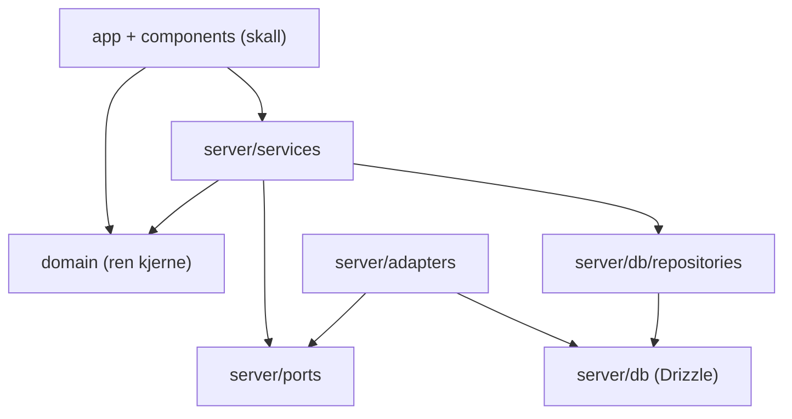
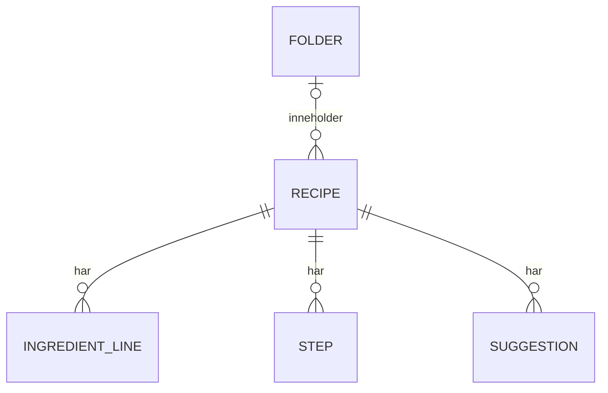
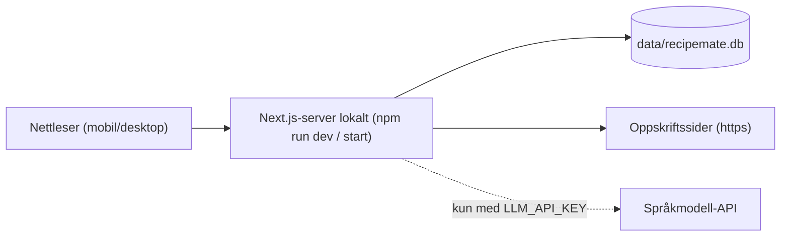

# Architecture Spine — RecipeMate

## Design Paradigm

**Funksjonell kjerne, imperativt skall.** All forretningslogikk (tolking av ingredienslinjer, skalering, formatering, normalisering av oppskriftsdata) ligger i en ren domenekjerne uten I/O. Rundt den ligger tjenester som orkestrerer og adaptere som gjør I/O (database, nettverk, språkmodell). Next.js App Router er skallet som viser sider og tar imot handlinger.

| Lag | Mappe | Inneholder |
| --- | --- | --- |
| Domene | `src/domain/` | Typer, tolking, skalering, formatering, normalisering. Rene funksjoner. |
| Tjenester | `src/server/services/` | Import, forslag, oppskrifter, mapper. Orkestrerer domene og porter. |
| Porter og adaptere | `src/server/ports/`, `src/server/adapters/` | Grensesnitt for henting, forslag og lagring, og implementasjonene deres. |
| Database | `src/server/db/` | Drizzle-skjema, tilkobling, repositorier. |
| App (skall) | `src/app/`, `src/components/` | Sider, Server Actions, React-komponenter. |



Pilene viser lovlige avhengigheter. Alt annet er forbudt.

## Invariants & Rules

### AD-1 — Domenekjernen er ren

- **Binds:** FR-3, FR-6, FR-7, FR-8, FR-9, NFR-2
- **Prevents:** Skaleringsregler spredt mellom komponenter og server, og logikk som ikke kan enhetstestes uten database eller nettverk.
- **Rule:** `src/domain/` importerer ikke fra `next`, `react`, `src/server/`, `src/app/`, database- eller nettverkspakker. Tolking og skalering av mengder finnes bare her og brukes både på server og i klient.

### AD-2 — Originalen lagres, skalering beregnes

- **Binds:** FR-1, FR-4, FR-7, FR-8, FR-13
- **Prevents:** Avrundingsfeil som hoper seg opp når skalerte verdier lagres og skaleres på nytt, og ulike kilder til sannhet for mengder.
- **Rule:** En ingredienslinje lagres med originaltekst og tolkede felt (mengde, enhet, navn, seksjon, rekkefølge). Oppskriften lagrer opprinnelig og sist valgt porsjonsantall. Skalerte mengder beregnes ved visning med `scaleLine(line, factor)` fra domenet og lagres aldri.

### AD-3 — Endringer via Server Actions med validering

- **Binds:** FR-4, FR-11, FR-13, FR-14, FR-15
- **Prevents:** To veier inn til samme endring (API-rute og action) med ulik validering.
- **Rule:** All skriving går gjennom Server Actions i `src/app/**/actions.ts`, som validerer input med zod og kaller en tjeneste. Lesing skjer i Server Components via tjenester. Ingen egne REST-ruter i v1.

### AD-4 — Import er en rørledning med porter

- **Binds:** FR-1, FR-2, FR-3, NFR-2, NFR-3
- **Prevents:** Import som bare kan testes mot nettet, og ulike måter å tolke oppskriftsdata på.
- **Rule:** Import går i faste steg: `validateUrl` → `RecipeSourceFetcher.fetch` (port) → `extractRecipeJsonLd` → `normalizeRecipe` (domene) → tolking av linjer (domene). Produksjon bruker HTTP-adapteren; tester bruker en adapter som leser `test/fixtures/html/`. Duplikatsjekk (FR-13) gjøres bare i `import-service`, på normalisert `sourceUrl` (uten fragment og sporingsparametere), før henting.

### AD-5 — Forslag bak én port, validert svar

- **Binds:** FR-10, FR-11, FR-12, NFR-1, NFR-2
- **Prevents:** Kall til språkmodell spredt i koden, appen som krasjer uten nøkkel, og usjekket modell-output i grensesnittet.
- **Rule:** `SuggestionProvider.suggest(recipe)` er eneste vei til forslag. Implementasjonen velges ett sted (`src/server/config.ts`): mock når `LLM_API_KEY` mangler, ellers språkmodell-adapteren. Alle svar valideres med zod-skjemaet `Suggestion` (1–3 elementer, felt `text`, `reason`, `appliesTo`) før de returneres. Mock-svar har `isExample: true`. Bare valgte forslag lagres (tabellen har ingen «hoppet over»-rader); et fjernet forslag slettes.

### AD-6 — Én eier av lagrede data

- **Binds:** FR-13, FR-14, FR-15, FR-16, NFR-1
- **Prevents:** Spørringer direkte fra sider eller komponenter, og skjema som endres uten migrasjon.
- **Rule:** Databasen er én SQLite-fil (`data/recipemate.db`, ikke i git). `src/server/db/schema.ts` er eneste skjemadefinisjon. Migrasjoner lages med drizzle-kit og committes. Bare repositoriene i `src/server/db/repositories/` bruker Drizzle.

### AD-7 — Feil som verdier

- **Binds:** FR-2, FR-4, FR-7, FR-10, FR-14
- **Prevents:** Ukontrollerte unntak som krasjer siden, og feilmeldinger skrevet på forskjellige måter.
- **Rule:** Tjenester returnerer `Result<T, AppError>` (`{ ok: true, value }` eller `{ ok: false, error: { kind, detail? } }`). `kind` er en fast streng (f.eks. `invalid_url`, `fetch_failed`, `no_recipe`, `duplicate`, `validation`, `suggestion_failed`). Norske brukermeldinger hentes fra `src/lib/messages.ts` basert på `kind`; ingen andre steder skriver feiltekst.

### AD-8 — Trygg henting av kilder

- **Binds:** FR-1, FR-2, NFR-3, NFR-4
- **Prevents:** At importen kan brukes til å nå maskinen selv eller interne nett, henger eller laster enorme sider.
- **Rule:** HTTP-adapteren godtar bare `http` og `https`, avviser adresser som løser til localhost, private eller lenkelokale nett (også etter omdirigering), avbryter etter 10 sekunder og leser maks 2 MB. HTML fra kilden vises aldri; bare tekstfelt fra oppskriftsdata brukes.

### AD-9 — Konfigurasjon og hemmeligheter

- **Binds:** NFR-1, NFR-4
- **Prevents:** Nøkler i koden og ulike steder som leser miljøvariabler.
- **Rule:** Miljøvariabler leses bare i `src/server/config.ts`, med ett smalt unntak: `src/instrumentation.ts` leser Nexts egen `process.env.NEXT_RUNTIME` for å starte opprydding bare i Node-kjøretiden (Story 3.2; `env-access.test.ts` låser unntaket til akkurat den variabelen). `.env.example` lister alle variabler uten ekte verdier. Appen starter uten `.env`.

### AD-10 — Avkrysning er klienttilstand

- **Binds:** FR-17
- **Prevents:** Avkrysning som blandes inn i lagret oppskrift eller påvirker skalering.
- **Rule:** Avkrysning holdes i React-tilstand i oppskriftsvisningen, nøklet på linje-ID, og lagres ikke.

### AD-11 — Testlag

- **Binds:** NFR-2, FR-8, FR-1, FR-2, SM-6
- **Prevents:** Tester som avhenger av nettet, en ekte språkmodell eller utviklerens database.
- **Rule:** Enhetstester (Vitest) for `src/domain/` dekker minst alle eksemplene i FR-8. Integrasjonstester for import bruker fixture-adapteren. Ende-til-ende-tester (Playwright) kjører mot en midlertidig database og mock-forslag. Ingen test gjør nettverkskall.

### AD-12 — Kontoer, økter og eierskap (versjon 2)

- **Binds:** FR-27, FR-13–FR-16, FR-23, FR-24, NFR-4, NFR-7
- **Prevents:** At en bruker ser eller endrer en annens oppskrifter, mapper eller «Har hjemme»; passord eller innloggingsnøkler som kan leses fra databasen; innlogging som avhenger av en ekstern tjeneste eller nøkkel (NFR-1).
- **Rule:** Tabellene `users` og `sessions` og kolonnen `user_id` på `recipes`, `folders` og `pantry_items` (migrasjon `0006_accounts`). Passord hashes med scrypt og eget salt; økten er et tilfeldig token i en httpOnly-cookie, og databasen har bare SHA-256 av tokenet. Cookien leses og skrives bare i `src/server/session.ts`. Tjenester for lister, mapper og «Har hjemme» tar `userId` som første parameter; enkeltoppskrifter sjekkes med `canAccessRecipe(viewer, id)` i hver Server Action og med `getRecipeFor` på sidene. En lagret oppskrift har alltid eier; en import uten innlogging har ingen eier og kan åpnes av alle med lenken til den lagres eller ryddes bort. En annens data gir `not_found`, aldri en egen «ingen tilgang»-feil.

## Consistency Conventions

| Concern | Convention |
| --- | --- |
| Språk | Kode, typer og filnavn på engelsk. All tekst brukeren ser er norsk bokmål. |
| Begreper | PRD-begrep → type: Oppskrift `Recipe`, Ingredienslinje `IngredientLine`, Ingrediensseksjon `section` (felt på linjen), Steg `Step`, Mappe `Folder`, Forslag `Suggestion`, Valgt forslag `Suggestion` med `status: 'applied'`, Favoritt `isFavorite`, Kilde `sourceUrl` + `sourceName`. |
| Filnavn | kebab-case for moduler (`scale-line.ts`), PascalCase for React-komponenter (`ServingStepper.tsx`), tester ved siden av koden som `*.test.ts`. |
| ID-er og datoer | Heltalls-ID-er fra SQLite. Tidspunkt lagres som ISO 8601-tekst i UTC. |
| Mengder | `Quantity = { min: number; max?: number }` (område når `max` finnes). Enheter normaliseres til faste nøkler (`g`, `dl`, `ss`, `tbsp` …) via én tabell i domenet. |
| Feil | `Result<T, AppError>` (AD-7). Klienten viser melding fra `messages.ts`. |
| Stil | Farger, typografi og avstander fra `DESIGN.md` som CSS-variabler i én global stilfil. Ingen hardkodede farger i komponenter. |
| Kodeformat | Prettier og ESLint (Next.js-oppsett); `npm run lint` og `npm test` skal være grønne før commit. |

## Stack

| Name | Version |
| --- | --- |
| Node.js | 22 LTS eller nyere |
| Next.js (App Router) | 16.4.5 |
| React / React DOM | 19.3.0 |
| TypeScript | 5.9.3 |
| ESLint (+ eslint-config-next) | 9.39.5 (16.4.5) |
| Prettier | 3.9.10 |
| Vitest (+ jsdom, Testing Library) | 5.1.0 (jsdom 30.1.3, @testing-library/react 16.3.3) |
| drizzle-orm + drizzle-kit | låses i package-lock.json når databasen innføres (Story 1.4) |
| better-sqlite3 | låses i package-lock.json når databasen innføres (Story 1.4) |
| zod | låses i package-lock.json når Server Actions innføres (Story 1.4) |
| cheerio | låses i package-lock.json når import innføres (Epic 2) |
| Playwright | låses i package-lock.json når ende-til-ende-tester innføres |

Versjonene er de som er låst i `package-lock.json`; `package.json` angir områder.

## Structural Seed





```text
G111-nilsen/
  src/
    domain/            # ren kjerne: types, parse-quantity, parse-line, scale-line, format-quantity, normalize-recipe, units
    server/
      config.ts        # eneste leser av miljøvariabler
      ports/           # RecipeSourceFetcher, SuggestionProvider
      adapters/        # http-fetcher, fixture-fetcher, mock-suggestions, llm-suggestions
      services/        # import-service, recipe-service, folder-service, suggestion-service
      db/              # schema.ts, client.ts, repositories/
    lib/               # result.ts, messages.ts
    app/               # sider og actions.ts per rute
    components/        # React-komponenter
    styles/            # tokens.css fra DESIGN.md
  drizzle/             # migrasjoner
  test/
    fixtures/html/     # lagrede oppskriftssider
    fixtures/suggestions/  # eksempelsvar for mock og tester
    e2e/               # Playwright
  data/                # lokal database (ignorert i git)
  .env.example
```

Kjøring: kun lokalt (`npm install`, `npm run db:migrate`, `npm run dev`). Ingen hosting eller sky-infrastruktur i v1.

## Capability → Architecture Map

| Capability / Area | Lives in | Governed by |
| --- | --- | --- |
| Import (FR-1–FR-3) | `services/import-service`, `adapters/http-fetcher`, `domain/normalize-recipe` | AD-4, AD-7, AD-8 |
| Manuell innlegging (FR-4) | `app/ny/actions.ts`, `services/recipe-service`, `domain/parse-line` | AD-2, AD-3 |
| Visning og avkrysning (FR-5, FR-6, FR-17) | `app/oppskrift/[id]`, `components/` | AD-1, AD-10 |
| Skalering og tolking (FR-7–FR-9) | `domain/` | AD-1, AD-2, AD-11 |
| Forslag (FR-10–FR-12) | `services/suggestion-service`, `ports/`, `adapters/*-suggestions` | AD-5, AD-7, AD-9 |
| Lagring, redigering, mapper, favoritter (FR-13–FR-16, FR-18) | `services/recipe-service`, `services/folder-service`, `db/repositories` | AD-3, AD-6 |
| Søk og filtrering (FR-20) | `domain/filter-collection`, `components/CollectionBrowser` | AD-1 |
| Kokemodus og mål (FR-19, FR-21, FR-22) | `components/CookingMode`, `components/UnitChoice`, `domain/convert-units`, `domain/step-ingredients` | AD-1, AD-2, AD-10 |
| Handleliste og «Har hjemme» (FR-23, FR-24) | `app/handleliste`, `domain/shopping-list`, `services/pantry-service` | AD-1, AD-3, AD-12 |
| Forslag uten nøkkel og i oppskriften (FR-25, FR-26) | `domain/suggest-for-recipe`, `domain/apply-suggestions`, `adapters/mock-suggestions` | AD-2, AD-5 |
| Kontoer og eierskap (FR-27) | `services/auth-service`, `server/session.ts`, `app/account-actions.ts`, `app/logg-inn`, `app/ny-konto` | AD-3, AD-7, AD-12 |
| Kjørbarhet og hemmeligheter (NFR-1, NFR-4) | `server/config.ts`, `.env.example`, README | AD-9 |

## Deferred

- **Leverandør og modell for forslag:** velges når forslags-epicen starter; må være billig og støtte JSON-svar. Grensesnittet (AD-5) gjør valget lokalt.
- **Hosting og deploy:** ikke i v1; appen kjøres lokalt etter README.
- **Konto, autentisering og flere brukere:** utenfor v1 (PRD §6); lokale kontoer kom i versjon 2 (AD-12). Glemt passord (krever e-post), begrensning av innloggingsforsøk og sletting av konto er fortsatt utsatt.
- **KI som reserve for import, søk og ingredienssubstitusjoner:** «hvis tid»; passer inn som nye tjenester uten å endre AD-ene.
- **Ytelse og caching:** ikke nødvendig for én lokal bruker.
