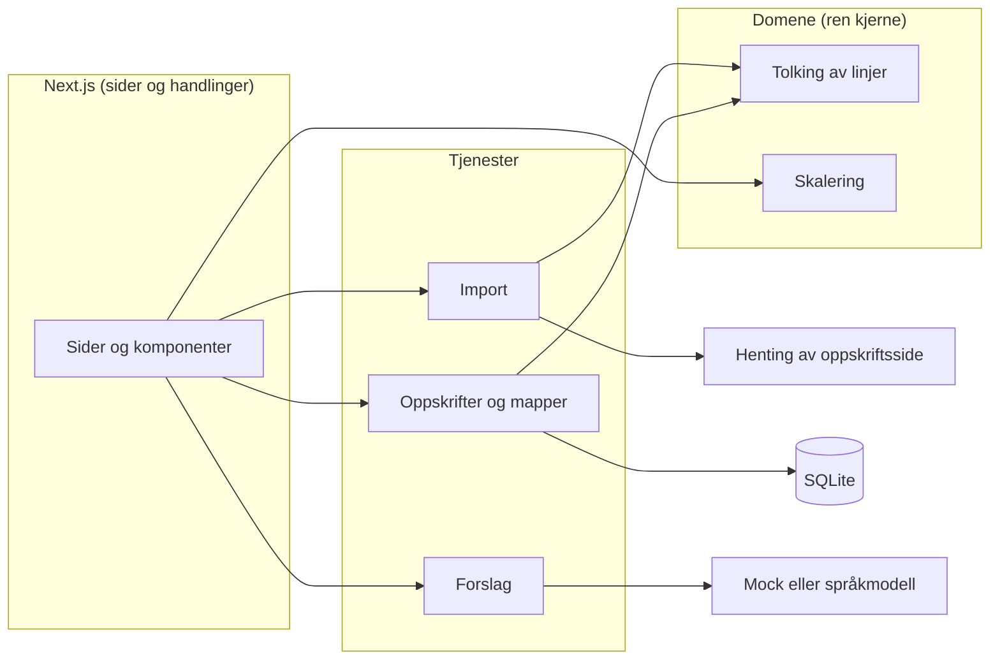

# Arkitekturen i RecipeMate – forklart

Dette dokumentet forklarer arkitekturen i vanlig språk: hva delene er, hvorfor de er valgt og hvordan man sporer et krav fra PRD-en til koden. Selve kontrakten for byggingen er [`ARCHITECTURE-SPINE.md`](ARCHITECTURE-SPINE.md). Alle beslutninger med begrunnelse er logget i [`.memlog.md`](.memlog.md).

## Kort fortalt

RecipeMate er én Next.js-app som kjører lokalt på maskinen, med en SQLite-fil som database. Det viktigste i appen er reglene for å tolke og skalere mengder, og de ligger i en egen, ren kjerne som ikke vet noe om nettsider, database eller språkmodeller. Alt rundt kjernen (henting av oppskrifter, lagring, forslag fra KI) går gjennom tydelige grensesnitt, slik at hver del kan testes for seg.

## De viktigste valgene og hvorfor

| Valg | Hvorfor | Alternativer som ble vurdert |
|---|---|---|
| **Funksjonell kjerne, imperativt skall** | Skaleringsreglene er appens viktigste regel. Når de er rene funksjoner, kan alle eksemplene i PRD-en testes direkte og raskt, uten database eller nettverk. | Logikk direkte i komponentene: raskere å starte, men vanskelig å teste og lett å få regler som er ulike på server og i nettleser. |
| **Next.js + TypeScript** | Én kodebase for grensesnitt og server, godt dokumentert og godt egnet for KI-assistert utvikling. | Egen frontend og backend: dobbelt oppsett for sensor. |
| **SQLite med Drizzle og better-sqlite3** | Én fil som database, ingen databaseserver å installere. Drizzle gir typesikre spørringer og migrasjoner som ligger i git. | `node:sqlite` (innebygd i Node, men nyere og mindre utprøvd), Prisma (tyngre oppsett). |
| **Originalen lagres, skalering beregnes** | Hvis skalerte tall ble lagret og skalert på nytt, ville avrundingsfeil hope seg opp (4 → 3 → 5 porsjoner). Originalen er alltid fasit. | Lagre skalerte mengder: enklere visning, men gir feil over tid. |
| **Forslag bak ett grensesnitt** | Appen skal virke uten nøkkel (sensor har ingen). En mock med lagrede eksempelsvar er standard. Valget av språkmodell kan tas senere uten å endre resten. | Kalle språkmodellen direkte der det trengs: ingen demomodus og vanskelig å teste. |
| **Validering av KI-svar** | Svar fra språkmodeller kan ha feil format. Alle svar sjekkes mot et skjema før de vises, og ugyldige svar avvises. | Vise svaret som det er: risiko for krasj eller rare forslag. |
| **Trygg henting av oppskriftssider** | Appen henter sider brukeren limer inn. Den skal ikke kunne brukes til å nå maskinen selv eller interne nett, og skal ikke henge på trege sider. | Hente alt uten begrensning: enklere, men usikkert. |
| **Feil som verdier med faste typer** | Hver feil har en fast type (f.eks. «ingen oppskrift funnet»), og alle norske feilmeldinger står ett sted. Det gir like og forståelige meldinger. | Kaste unntak: lett å glemme å fange dem, og meldingene blir ulike. |

## Slik henger import sammen

1. Brukeren limer inn en lenke.
2. Lenken sjekkes (bare http/https, ikke lokale adresser) og sammenlignes med lagrede oppskrifter for å unngå duplikater.
3. Siden hentes med tidsavbrudd og størrelsesgrense.
4. Oppskriftsdata (schema.org `Recipe` i JSON-LD) leses ut av HTML-en.
5. Dataene gjøres om til appens eget format, og hver ingredienslinje tolkes i kjernen.
6. Mangler porsjonsantall, spør appen brukeren (FR-3).

I testene byttes steg 3 ut med en adapter som leser lagrede sider fra `test/fixtures/html/`. Derfor avhenger ingen test av nettet.

## Fra krav til kode

Hvert krav i PRD-en har en fast ID (FR-1 til FR-17). Spinen har en tabell («Capability → Architecture Map») som viser hvor hvert krav bor i koden og hvilken regel (AD-1 til AD-11) som styrer det. Stories i neste steg viser til de samme ID-ene, og commit-meldinger og tester gjør det samme. Slik kan man følge et krav fra PRD til story, kode og test.

| Eksempel | PRD | Arkitektur | Kode | Test |
|---|---|---|---|---|
| Skalering | FR-8 (10 eksempler) | AD-1, AD-2 | `src/domain/scale-line.ts` | `scale-line.test.ts` med alle eksemplene |
| Import feiler | FR-2 | AD-4, AD-7, AD-8 | `src/server/services/import-service.ts` | integrasjonstest mot lagret oversiktsside |
| Demomodus | FR-12 | AD-5, AD-9 | `src/server/adapters/mock-suggestions.ts` | test uten `LLM_API_KEY` |

## Testing

- **Enhetstester** for kjernen: tolking og skalering, med alle eksemplene fra PRD-en som fasit.
- **Integrasjonstester** for import mot lagrede oppskriftssider.
- **Ende-til-ende-tester** for kjerneflyten (importer, skaler, lagre i mappe, finn igjen), med midlertidig database og mock-forslag.

## Begrensninger og åpne punkter

- Valg av språkmodell er utsatt til forslagene bygges. Kravet er at den skal være billig og kunne svare i JSON.
- Appen kjøres bare lokalt. Hosting, konto og flere brukere er bevisst utenfor v1.
- Pakkeversjoner (utenom Next.js 16.4) låses i `package-lock.json` ved første installasjon.
